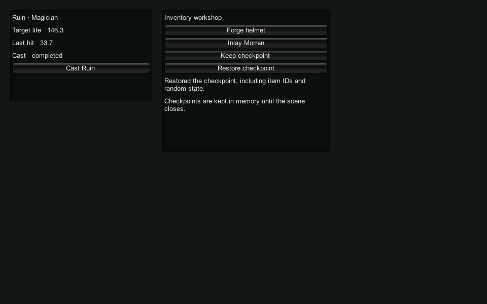

# Unity workshop integration

The Unity UPM package `com.hollowwake.gameplay` 0.2.0-preview.1 adds
crafting, equipment, learned skills, support custody and vestige inlays to
the existing combat and pouch package. The accepted tarball is 1,496,440 bytes;
its SHA-256 is
`ea56ce53d14a5c0b669ba1dcc05e96e90ea768994ac682e6ec54c5fd38577c76`.
The original game checkout and prior accepted evidence were not changed.

The [public preview release](https://github.com/arianna-arpg/hollow-wake-engine/releases/tag/unity-workshop-v0.2.0-preview.1)
targets `1c1218d17d507a0d784919eb911936358c4a6b31`. Its five asset digests and
resolved tag were checked after publication; see [publication.json](publication.json).
All 15 applicable hosted workflows pass across the runtime-identical checkpoints
identified in [hosted-validation.json](hosted-validation.json). That record
retains the failed and superseded attempts as well as the accepted runs.
The attached native-control receipts are also retained here.

The [follow-up cleanup record](followup-cleanup.json) accounts for verification
fixtures and compiler outputs removed after publication. The accepted delivery
and its small comparison archives remain available locally.

## Actual host acceptance

[Windows results](windows.json) come from Unity 2021.3.6f1, Windows x64 Mono.
Package Manager installed the tarball in an isolated project and imported its
sample. Both the editor and relocated exported player matched 56 immutable
original workshop replies, 60 combat replies and the existing 2,334 pouch
checks. The typed workshop facade additionally verified IDs above 32 bits,
automatic next-ID selection, learned skill/support custody, refused profile
overrides, independent owners, invalid restore, and exact item/random-stream
continuation. Retiring a profile invalidates its old handle.

Two exits from real Play mode with domain reload disabled released the
workshop and pouch hosts. Altered workshop and pouch content failed their
hash checks while the independent combat host still opened. All tracked
native allocations were released on close.

The sample forged and inlaid a helmet, captured a checkpoint, made another
item, and restored the exact checkpoint. The real rendered player was also
inspected at 960 by 600:

The capture uses an ordinary graphical player. An earlier batch-mode capture
was black despite successful numeric checks; it is not accepted visual
evidence. The verifier now rejects a capture without sufficient visible
pixels. Unity documents that
[batch mode displays nothing](https://docs.unity3d.com/2021.3/Documentation/Manual/PlayerCommandLineArguments.html);
capture follows rendering using
[WaitForEndOfFrame](https://docs.unity3d.com/2021.3/Documentation/ScriptReference/ScreenCapture.CaptureScreenshotAsTexture.html).
Sample actions were invoked through the component methods, not an automated
mouse/controller course.

## Shared policy and content

The builder consumes the accepted 0.59 SDK and fresh Godot content archives.
It compares every installed SDK runtime file to the freshly built workspace
runtime. The native DLL is byte-identical to the previously accepted Windows
DLL. Receipts pin all package source, content and library hashes.

Unity calls the same workshop dispatcher as Godot using ordinary JSON.
The typed C# envelope preserves arbitrary item/save bodies as opaque JSON
strings, avoiding Unity's field serializer for dictionaries and numeric
continuation state. Per-profile handles prohibit owner overrides and lifecycle
commands. The host remains responsible for station/action authority.

[Godot compatibility](godot-dispatch.json) checks all current capability
contracts and the original 56 commands through the rebuilt numeric wire.
This is a JavaScript packaged-content replay, not a new Godot native run.
Existing Windows/Linux native evidence is retained separately.

## Measured costs and rejected experiment

The accepted workshop course peaks at 32,810,277 tracked native bytes within
its 32 MiB heap limit. Workshop content loads only when requested and its
context supports two independent profiles. This excludes managed allocations,
Unity assets, graphics and other process memory.

An [alternating comparison](footprint.json) tried shortening private method
names with the same DLL, content and original 56 requests. Both variants
returned identical replies and released every allocation. Code shrank from
114,411 to 113,511 bytes; tracked peak fell by 50,651 bytes (about 0.15%).
Allocation calls rose from 99,130 to 128,323 (about 29%). The experiment was
rejected: there is no measured time or device benefit to justify that tradeoff.
The final package's workshop code matches the unmodified comparison variant.
The two small comparator archives are retained with the local delivery so
the measurement can be repeated. Their hashes are in the comparison receipt.

The retained combat table/catch-up checks also pass. Unity's managed allocation
counter failed its control and remains unavailable. Raw timings in the host
receipt are observations during concurrent validation, not performance claims.
The separate SDK benchmark runs without the other verification jobs.

## Reproduce

Use the verified 0.57 Windows pouch release and 0.59 fresh Windows workshop
release as inputs. From the SDK root:

~~~text
node scripts/package-unity-gameplay.mjs POUCH_RELEASE_DIR NEW_PACKAGE_DIR PYTHON FRESH_WORKSHOP_DIR
python -I -B scripts/verify-unity-gameplay.py --editor UNITY_EXE --package NEW_PACKAGE_DIR --release POUCH_RELEASE_DIR --receipt NEW_RECEIPT --render
node test/unity-gameplay/godot-dispatch.mjs DISPOSABLE_ACCEPTED_ASSETS_DIR NEW_RECEIPT
python -I -B test/unity-gameplay/workshop-footprint.py BEFORE_TAR AFTER_TAR SHIPPED_DLL FROZEN_COURSE_DIR NEW_RECEIPT
~~~

The normal verifier owns and removes its project, cache and player on exit.
Its optional `--work` path permits reuse only with a matching ownership marker;
the caller then owns final cleanup. Full SDK verification is recorded as a
composite: its initial run passed through attack-sequence mutation checks,
then failed because the restricted environment denied access to an external
temporary consumer. The exact suffix was rerun with the required access and
an isolated temporary root. The damage-package check now removes its consumer
even on failure. The failed invocation is kept distinct from acceptance.

## Remaining boundaries

This sample stores checkpoints in memory. Unity durable transactions and
synchronization between workshop equipment and the separately owned combat
build remain integration work. IL2CPP, other Unity versions/platforms, ARM,
physical Steam Deck and older-mobile memory, latency and power measurements
are unverified. This is a qualified Windows preview, not complete SDK delivery.
